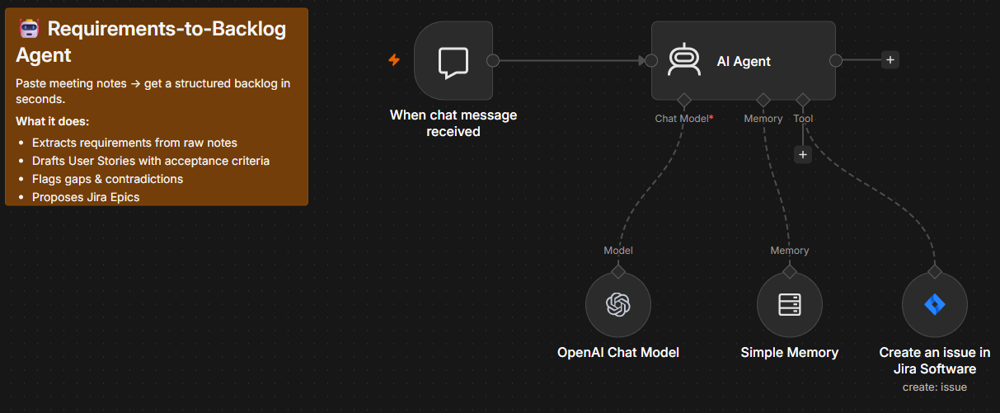

# Requirements-to-Backlog Agent

Built in n8n. Paste meeting notes or a stakeholder transcript into the chat. The agent extracts requirements, drafts user stories with acceptance criteria, flags gaps and contradictions, and creates Epics in a Jira project.

**Stack:** n8n, OpenAI GPT-4.1, Simple Memory, Jira Software (create issue)

