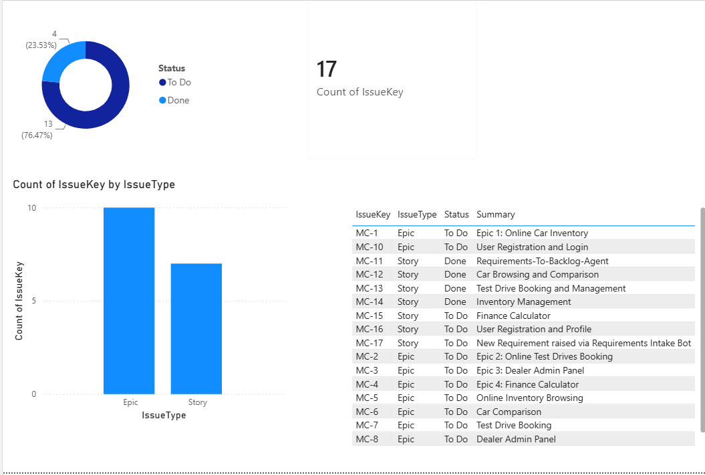

# BA Dashboard

Built in Power BI Desktop and published to Power BI Service. The report pulls issue data from a Jira project through the Jira REST API (GET) and shows delivery status at a glance: issues by status, a count by issue type (Epic and Story), the total issue count, and a full issue list with keys, types, statuses and summaries.

**Stack:** Power BI Desktop, Power BI Service, Jira REST API (GET)

