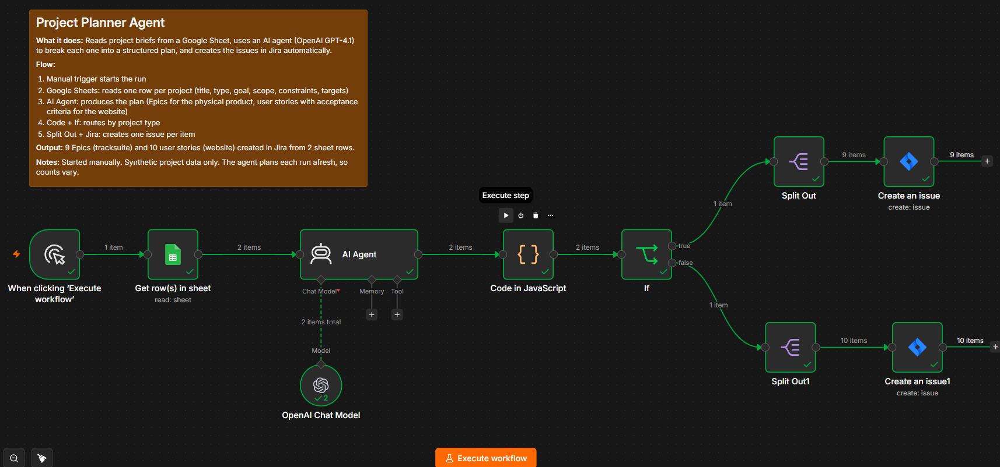
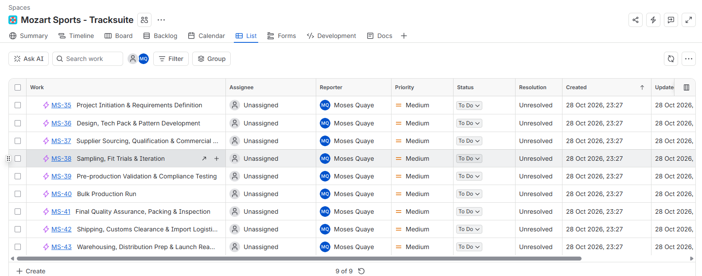
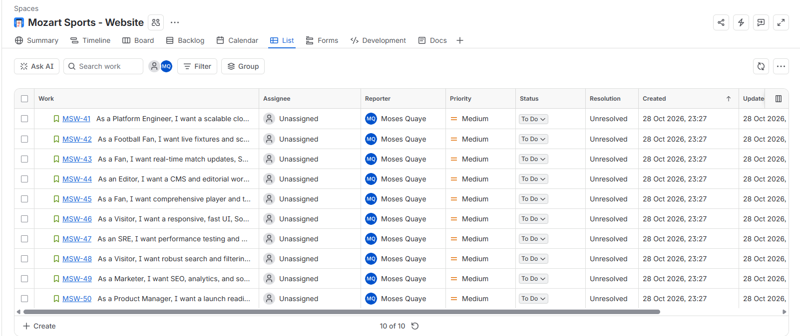

# 06 - Project Planner Agent (n8n + OpenAI + Jira)

An n8n workflow that reads project briefs from a Google Sheet, uses an AI agent to turn each brief into a structured delivery plan, and creates the work items in Jira automatically.

## What it does
- Reads one row per project from a Google Sheet (title, type, goal, scope, constraints, quality targets).
- An AI agent (OpenAI GPT-4.1) plans each project:
  - **Physical product** (tracksuit): phased **Epics** with a duration and start/end dates.
  - **Website**: **user stories** with acceptance criteria, edge cases, assumptions, and story point estimates.
- A Code node parses the agent's output, and an If node routes by project type.
- Split Out + Jira nodes create one issue per plan item.

## Example run
Two sheet rows produced:
- 9 Epics in the *Mozart Sports - Tracksuite* Jira space (start dates set)
- 10 user stories in the *Mozart Sports - Website* Jira space (story points set)

## Stack
n8n (self-hosted), Google Sheets (service account), OpenAI GPT-4.1, Jira Cloud REST API.

## Limitations
- Started manually. It is not yet on a schedule.
- Run on two synthetic project briefs only. The quality of the plans has not been formally evaluated.
- Each run plans afresh, so counts and wording vary, and re-running creates duplicate issues.
- Epics get start dates only. End dates are left for the team to set.
- Issues are not assigned, and no human approval step is included.
